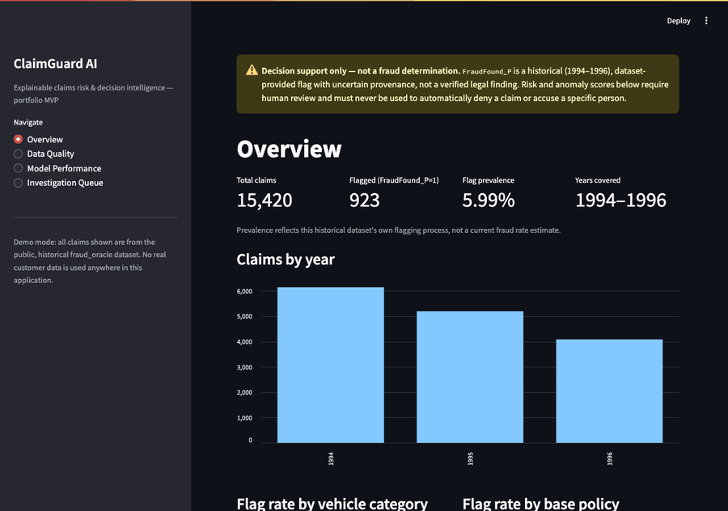
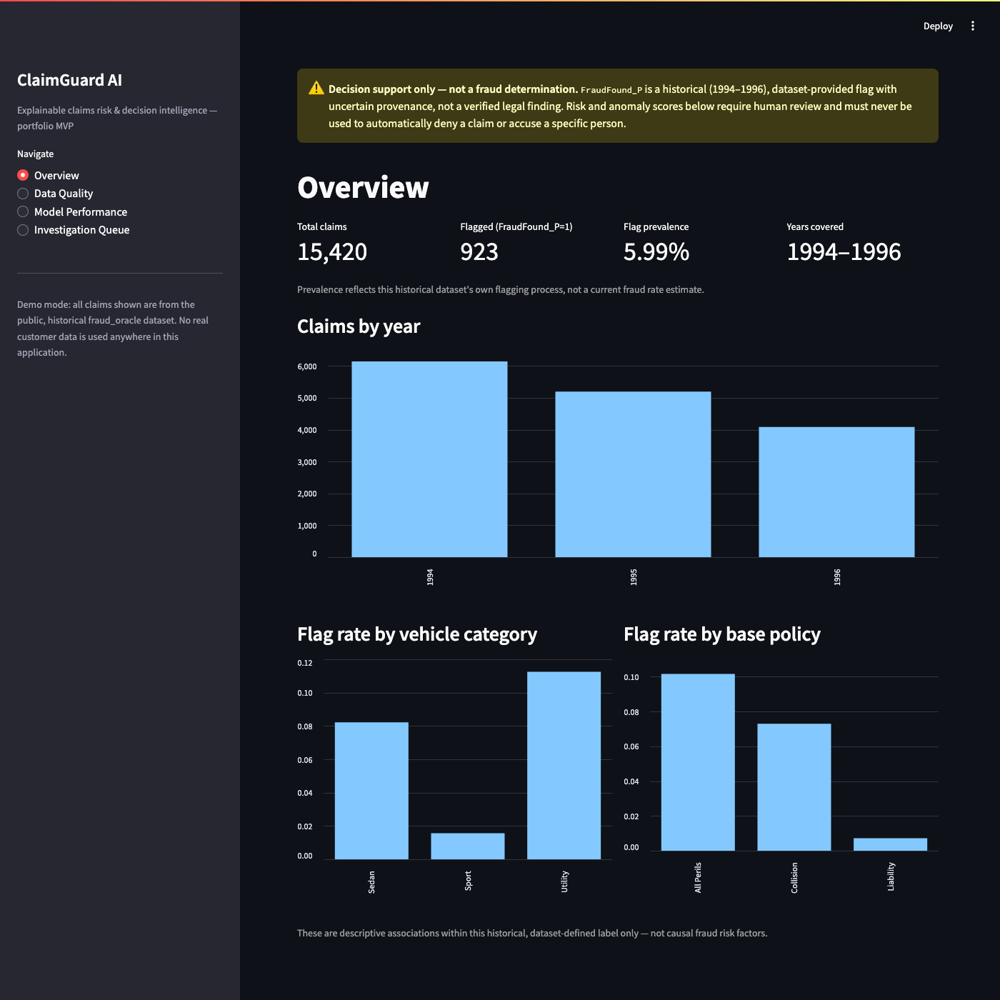
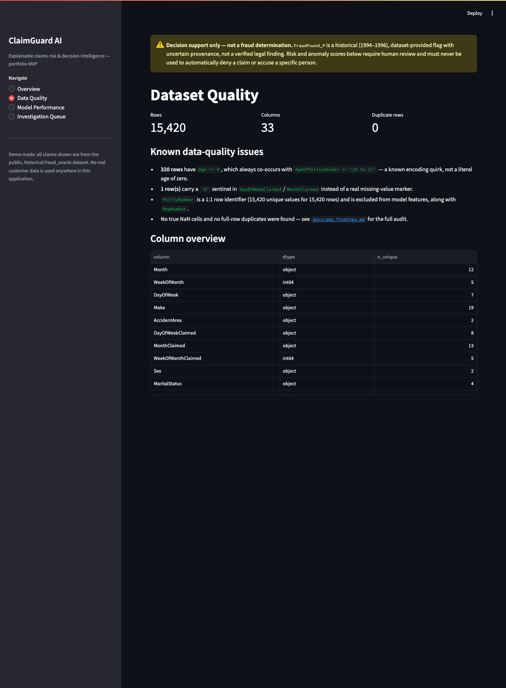
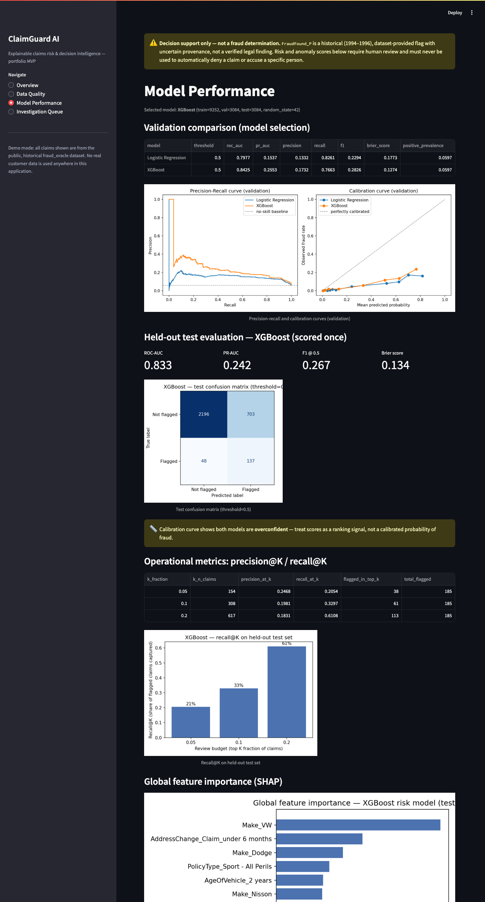
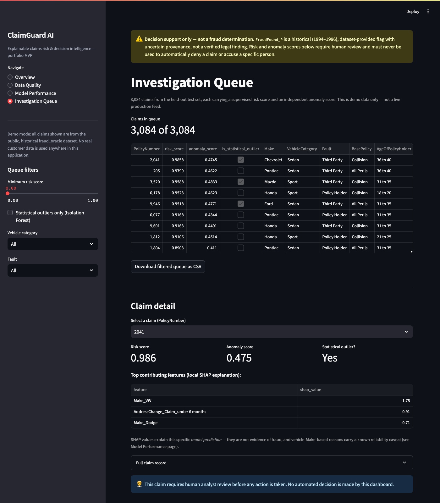
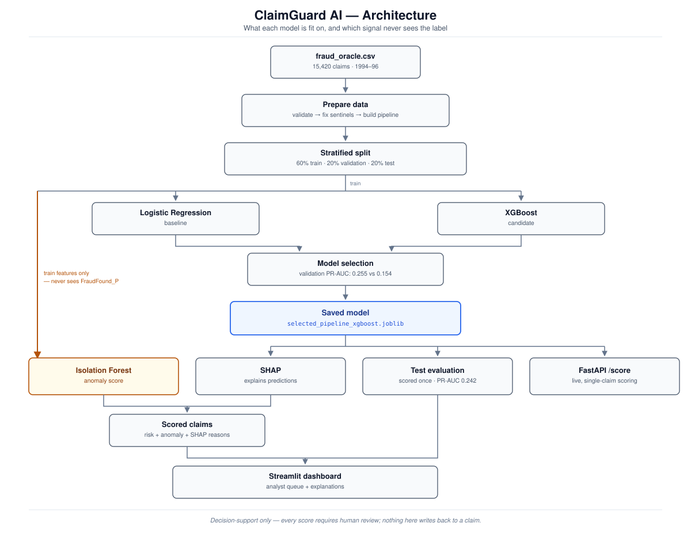

# ClaimGuard AI

Explainable insurance claims risk analytics: supervised ML, anomaly detection, SHAP explanations, and an analyst-focused dashboard.

> **Status: Week 4 (local parts) complete — not yet published or deployed.** Data validated, EDA complete, baseline Logistic Regression + XGBoost trained and evaluated, SHAP explanations and Isolation Forest anomaly detection added, a working Streamlit dashboard, an optional FastAPI scoring endpoint, a test suite with CI-safe fixtures, a GitHub Actions workflow, and a Dockerfile. **Deliberately not yet done, by request: pushing this repository to GitHub and deploying a public demo.** See [`ClaimGuard_AI_Project_Plan.md`](ClaimGuard_AI_Project_Plan.md) for the full spec and roadmap, and [`docs/model_card.md`](docs/model_card.md) for the consolidated model summary.

## What this is

ClaimGuard AI is an analyst-facing decision-support tool for triaging historical vehicle insurance claims. It will estimate the relative probability of a *dataset-defined* suspicious/fraud-reported claim, flag statistically anomalous claims, explain its outputs, and help prioritize a review queue — it does **not** determine that anyone committed fraud, and it will never auto-deny a claim.

## Dataset

[Vehicle Insurance Claim Fraud Detection](https://www.kaggle.com/datasets/shivamb/vehicle-claim-fraud-detection) (Kaggle) — 15,420 historical claims from 1994–1996, target `FraudFound_P` (5.99% positive). See [`docs/data_dictionary.md`](docs/data_dictionary.md) for every field, [`docs/eda_findings.md`](docs/eda_findings.md) for quality findings and caveats, and [`docs/dataset_acquisition.md`](docs/dataset_acquisition.md) for step-by-step download instructions. The raw CSV is not committed to this repo (see `.gitignore`) — download it from Kaggle and place it at `data/raw/fraud_oracle.csv`.

## Current model (held-out test set)

Selected model: **XGBoost** (beat the Logistic Regression baseline on validation PR-AUC). Full numbers, curves, and caveats in [`docs/model_evaluation.md`](docs/model_evaluation.md) — produced by [`notebooks/02_baseline_modeling.ipynb`](notebooks/02_baseline_modeling.ipynb), not hand-typed.

| Metric | Value |
|---|---|
| ROC-AUC | 0.833 |
| PR-AUC | 0.242 |
| Recall@top 20% reviewed | 61% |
| Brier score | 0.134 |

**Important:** the model is overconfident (see calibration curve in the evaluation doc) — treat its output as a *ranking* signal for triage, not a calibrated fraud probability, and never as an automated decision.

**Stability check:** retrained/re-evaluated across 5 random seeds — PR-AUC ranged 0.242–0.265 (mean 0.251, std ≈0.01). The headline number above is at the low end of that range, not a favorable cherry-pick. Details in [`docs/model_evaluation.md`](docs/model_evaluation.md).

## Explainability & anomaly detection

SHAP explains each prediction (global + per-claim), and an independent, unsupervised Isolation Forest flags statistically unusual claims (fit without ever seeing `FraudFound_P`). Full writeup, including an honestly-reported limitation (SHAP importance is partly dominated by rare vehicle-`Make` categories), in [`docs/explainability_and_anomaly.md`](docs/explainability_and_anomaly.md).

## Dashboard

```bash
streamlit run app/dashboard/app.py
```

Four pages: **Overview** (claim volume/prevalence), **Data Quality** (the EDA findings, live), **Model Performance** (validation/test metrics, PR/calibration curves, SHAP importance), and **Investigation Queue** (filterable, ranked by risk score, with per-claim SHAP + anomaly detail and CSV export). Runs entirely on the public historical dataset — no real customer data. Pages and queue filters are deep-linkable (e.g. `?page=Investigation+Queue&vehicle=Sport&min_risk=0.3`) for bookmarking/sharing.



| Overview | Data Quality |
|---|---|
|  |  |

| Model Performance | Investigation Queue |
|---|---|
|  |  |

(Captured headlessly from the actual running app — not mockups.)

## Optional API

```bash
uvicorn app.api.main:app --reload
```

`GET /health`, `POST /score` (returns a risk score + disclaimer for a single claim; input validated via Pydantic). Decision-support only — see [`docs/model_card.md`](docs/model_card.md).

## Architecture



See [`docs/architecture.md`](docs/architecture.md) for the full writeup (same diagram plus a Mermaid source version and a layer-responsibility table).

## Testing & CI

```bash
pytest tests/ -v
ruff check src/ app/ tests/
```

20 tests, all passing. Tests that need the licensed dataset or a trained model artifact are marked and skip cleanly when those aren't present (e.g. in CI) — everything else runs against a small synthetic fixture (`tests/fixtures/sample_claims.csv`, not derived from the real dataset). A GitHub Actions workflow is defined at [`.github/workflows/ci.yml`](.github/workflows/ci.yml) (runs on push once this repo is actually published).

## Docker

A `Dockerfile` is included for the dashboard. **Not yet built/verified** — Docker isn't installed in this project's current dev environment, so treat it as a documented starting point, not a tested artifact:

```bash
docker build -t claimguard-ai .
docker run -p 8501:8501 -v $(pwd)/data:/app/data -v $(pwd)/models:/app/models -v $(pwd)/reports:/app/reports claimguard-ai
```

## Project structure

```
docs/               specification, data dictionary, EDA findings
data/raw/            gitignored external data (download separately)
data/processed/      gitignored generated outputs
notebooks/           exploration and modeling notebooks
src/data/            loaders, validators, preprocessing
src/features/        feature definitions
src/models/          train, evaluate, score, save
src/explainability/  SHAP / interpretation
src/anomaly/         anomaly detection
app/dashboard/        Streamlit UI
app/api/              optional FastAPI service
tests/                test suite (+ fixtures/ synthetic CI fixture)
reports/figures/      output plots
.github/workflows/    CI (ruff + pytest)
Dockerfile            dashboard image (not yet built/verified — no Docker locally)
```

## Setup

```bash
python3 -m venv .venv
source .venv/bin/activate
pip install -r requirements.txt
```

Then download `fraud_oracle.csv` from Kaggle into `data/raw/`, and open [`notebooks/01_eda.ipynb`](notebooks/01_eda.ipynb).

## Responsible use

This is a portfolio/research project. Public dataset labels are historical (1994–1996), of uncertain provenance, and must never be treated as confirmed legal fraud determinations. Any risk score this system eventually produces is a model estimate requiring human review — not evidence, not an eligibility decision, and not a current-day calibrated fraud probability. See [`ClaimGuard_AI_Project_Plan.md`](ClaimGuard_AI_Project_Plan.md) §10 for full Responsible AI guidance.

## Roadmap

See [`ClaimGuard_AI_Project_Plan.md`](ClaimGuard_AI_Project_Plan.md) for the complete 4-week plan. Current progress:

- [x] Week 1 — data selection, quality validation, EDA, data dictionary, project scaffolding
- [x] Week 2 — baseline + tree-ensemble modeling, imbalance handling, evaluation
- [x] Week 3 — SHAP explanations, Isolation Forest anomalies, Streamlit dashboard
- [x] Week 4 (local) — tests, CI workflow, FastAPI endpoint, Dockerfile, model card, architecture diagram, dashboard screenshots, seed-stability check
- [ ] Week 4 (remaining, on hold by request) — publish to GitHub, deploy a public demo
