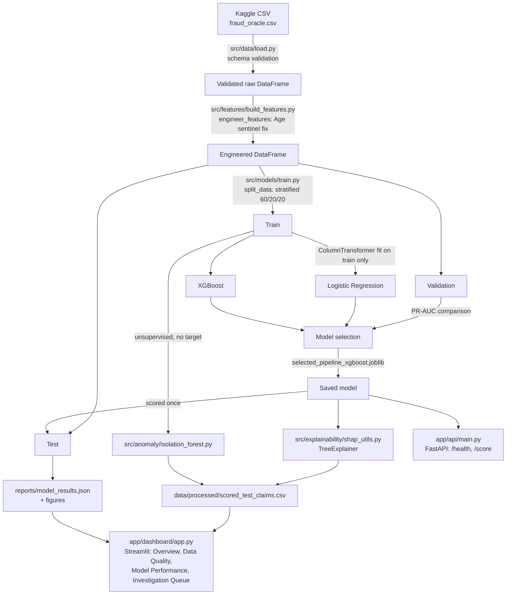

# Architecture

## Boundary

The dashboard and API are decision-support surfaces only. Nothing in this architecture automatically denies a claim, accuses an individual, or writes back to any claims system — every scored output carries a human-review disclaimer (see [`docs/model_card.md`](model_card.md)).

## Layer responsibilities

| Layer | Module | Responsibility |
|---|---|---|
| Ingestion | `src/data/` | Load CSV, validate schema against `src/data/schema.py` |
| Features | `src/features/` | Split-safe recoding (Age sentinel), train-only preprocessing pipeline |
| Modeling | `src/models/` | Stratified split, pipeline construction, evaluation metrics |
| Explainability | `src/explainability/` | SHAP global + per-claim local explanations |
| Anomaly | `src/anomaly/` | Unsupervised Isolation Forest, independent of the target |
| Presentation | `app/dashboard/` | Streamlit analyst UI |
| Serving (optional) | `app/api/` | FastAPI scoring endpoint for programmatic access |
