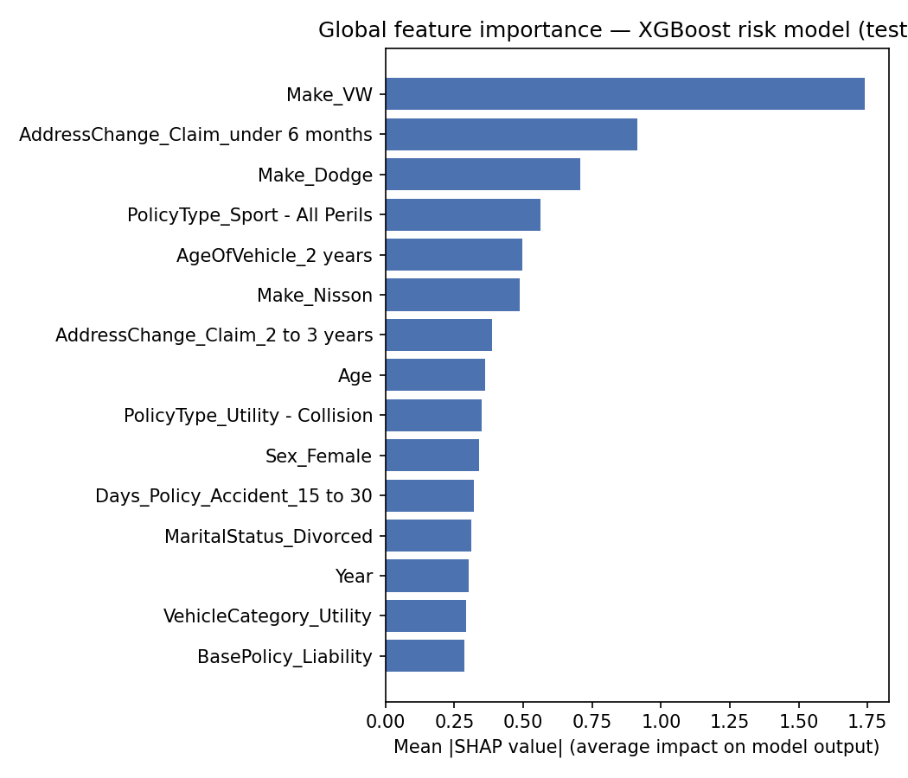
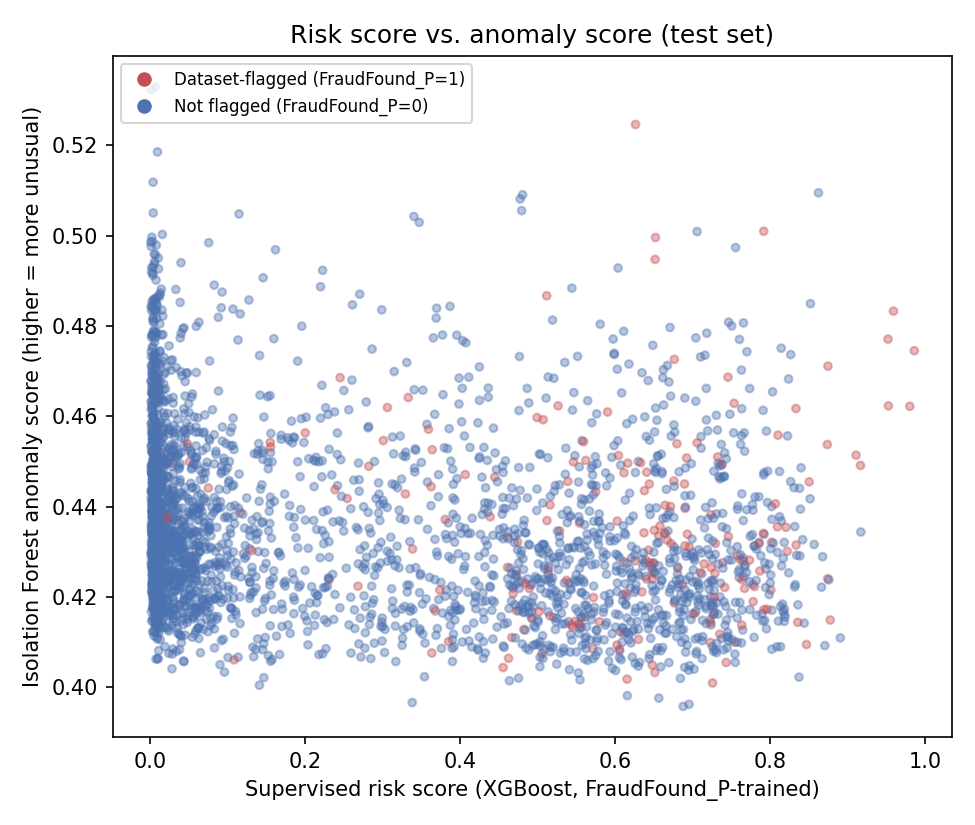

# Week 3 — Explainability & Anomaly Detection

**Reproducible source:** [`notebooks/03_explainability_and_anomaly.ipynb`](../notebooks/03_explainability_and_anomaly.ipynb), executed end-to-end with no errors.
**Artifacts:** `models/isolation_forest_pipeline.joblib` (gitignored), `data/processed/scored_test_claims.csv` (gitignored), figures in `reports/figures/`.

## 1. Global SHAP feature importance

Computed with `shap.TreeExplainer` on the Week 2 XGBoost model, scored on the held-out test set (3,084 claims, 143 features after one-hot encoding).

**Known limitation, reported honestly:** the top features are dominated by a handful of **rare vehicle-`Make` categories** (`Make_VW`, n=283; `Make_Dodge`, n=109; `Make_Nisson`, n=30), which have distinctly lower fraud rates in this dataset (VW 2.8%, Dodge 1.8%, Nisson 3.3%, vs. 6.0% overall). Inspecting individual explanations (Section 2) showed the **same** handful of rare-category features dominating both the highest-scored and the lowest-scored test claims with nearly identical magnitudes — a pattern consistent with SHAP instability on sparse one-hot dummies for small-sample tree splits, not a reliable, generalizable signal. This is flagged as a concrete follow-up: group low-count `Make` levels into an `Other` bucket, or increase `min_child_weight`/regularization, before treating per-claim vehicle-make explanations as trustworthy. **Do not present `Make`-based SHAP output to end users without this fix.**

## 2. Per-claim local explanations

Implemented via `src/explainability/shap_utils.explain_instance` — returns each claim's top contributing features and their signed SHAP values. This is what powers the dashboard's claim-detail view (Week 3 Streamlit app).

Given the rare-category caveat above, the dashboard surfaces local explanations with an explicit on-screen disclaimer, and non-`Make` features (e.g., `AddressChange_Claim`, `Age`, `AgeOfVehicle`) are the more interpretable part of each explanation.

**Standing rule (from project plan §10):** SHAP explains the *model's* prediction. It is never presented as a cause of fraud or as evidence.

## 3. Isolation Forest — independent anomaly signal

Fit on the **training fold only**, using no label at all (fully unsupervised — `FraudFound_P` is never passed to `.fit()`). `contamination=0.06` is a reporting convenience near the dataset's own flag rate; it does not imply outliers are fraud.

- **175 of 3,084 test claims (5.7%) flagged as statistical outliers.**
- Correlation between the supervised risk score and the anomaly score: **r = -0.18** (weak negative) — confirming these are genuinely different signals, not a relabeled version of the same thing.

The scatter shows no diagonal relationship: high-risk-score claims and high-anomaly-score claims are largely different claims. Both scores (and the dataset's `FraudFound_P` flag, shown by point color) are kept and displayed **separately** in the dashboard — never combined into a single number.

## 4. Scored output

`data/processed/scored_test_claims.csv` carries, per test claim: `risk_score` (XGBoost), `anomaly_score` and `is_statistical_outlier` (Isolation Forest), `top_shap_reasons` (top-3 local SHAP features), and the original `FraudFound_P` for reference. This is the data source for the Week 3 Streamlit investigation queue.

## Caveats (carried forward, still binding)

- Historical, 1994–1996, dataset-defined label — findings describe this dataset only.
- SHAP explains model behavior, not fraud causation; the rare-category instability above (Section 1) is an open issue, not a solved one.
- Isolation Forest anomaly flag means "statistically unusual," not "likely fraud" — the weak/negative correlation with the risk score is the evidence for treating them as separate signals.
- Neither score is a basis for automated action; both require human review.
