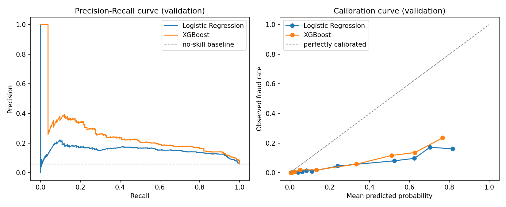
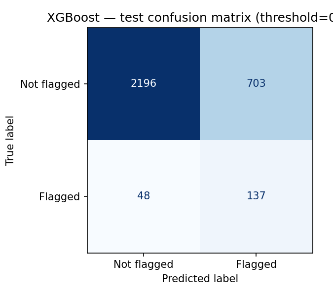
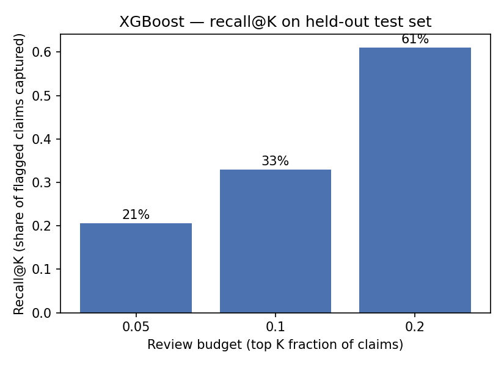

# Week 2 — Model Evaluation

**Reproducible source:** [`notebooks/02_baseline_modeling.ipynb`](../notebooks/02_baseline_modeling.ipynb), executed end-to-end with no errors.
**Raw numbers:** [`reports/model_results.json`](../reports/model_results.json)
**Saved artifact:** `models/selected_pipeline_xgboost.joblib` (gitignored — reproduce via the notebook)

All numbers below are copied directly from that run (`random_state=42`). Nothing here is invented or rounded from memory.

## Split

Stratified 60/20/20 train/validation/test split, preserving the ~6% positive prevalence in each:

| Split | n | positive rate |
|---|---|---|
| Train | 9,252 | 5.97% |
| Validation | 3,084 | 5.97% |
| Test | 3,084 | 6.00% |

Preprocessing (imputation, scaling, one-hot encoding) is fit only on the training fold (`src/features/build_features.py`, `src/models/train.py`). `AgeUnknown` flag + `Age==0 → NaN` recoding is applied row-wise before the split since it uses no aggregate statistic (see data dictionary).

## Candidates trained

1. **Logistic Regression** — `class_weight='balanced'`, L2-regularized, scaled numeric features.
2. **XGBoost** — 300 trees, max_depth=4, `scale_pos_weight` computed from the **training fold only** (≈15.7).

## Validation comparison (model selection, before touching test)

| Model | ROC-AUC | PR-AUC | Precision@0.5 | Recall@0.5 | F1@0.5 | Brier score |
|---|---|---|---|---|---|---|
| Logistic Regression | 0.798 | 0.154 | 0.133 | 0.826 | 0.229 | 0.177 |
| **XGBoost** | **0.842** | **0.255** | 0.173 | 0.766 | 0.283 | **0.127** |

XGBoost wins on every metric, most importantly **PR-AUC** (the metric that matters most at ~6% prevalence): 0.255 vs. 0.154 — roughly a 66% relative improvement over the logistic baseline. **XGBoost was selected** using validation data only.

## Held-out test evaluation (XGBoost, scored once)

| Metric | Value |
|---|---|
| ROC-AUC | 0.833 |
| PR-AUC | 0.242 |
| Precision @ threshold 0.5 | 0.163 |
| Recall @ threshold 0.5 | 0.741 |
| F1 @ threshold 0.5 | 0.267 |
| Brier score | 0.134 |
| Confusion matrix | TN=2196, FP=703, FN=48, TP=137 |

Test PR-AUC (0.242) is close to validation PR-AUC (0.255) — no evidence of overfitting to the validation split.

### What the default 0.5 threshold means operationally

At the default classification threshold, the model flags 840 of 3,084 test claims (27%) to catch 137 of 185 actually-flagged claims (74% recall), at 16% precision. That is a very large review workload for a ~16% hit rate — in practice an analyst team would use a ranked queue with a review-budget threshold (below) rather than a fixed 0.5 cutoff.

## Operational metrics: precision@K / recall@K (test set, ranked queue)

| Review budget (K) | Claims reviewed | Precision@K | Recall@K |
|---|---|---|---|
| Top 5% | 154 | 24.7% | 20.5% |
| Top 10% | 308 | 19.8% | 33.0% |
| Top 20% | 617 | 18.3% | **61.1%** |

Reading the top 20% of test claims by model score would require reviewing 617 claims to catch 113 of the 185 dataset-flagged claims (61%) — roughly a 3x enrichment over randomly sampling 20% of the queue (which would catch ~20% of flags by chance).

## Calibration — important limitation

Both models are **overconfident**: in the calibration curve, predicted probabilities in the 0.6–0.8 range correspond to an observed fraud rate of only ~15–23%, not 60–80%. **Do not present the model's output as a literal probability of fraud.** It is a useful *ranking* score (confirmed by the PR-AUC and precision/recall@K results above) but is not a calibrated probability without further work (e.g., Platt scaling or isotonic regression fit on a held-out calibration fold — a candidate post-MVP improvement).

## Model stability across random seeds

Per the project plan's measurement guidance (§9), the same pipeline was retrained and re-evaluated on 5 independently-seeded stratified splits (seeds 42, 7, 123, 2024, 999). Full numbers in [`reports/seed_stability_results.json`](../reports/seed_stability_results.json) and reproducible in Section 10 of [`notebooks/02_baseline_modeling.ipynb`](../notebooks/02_baseline_modeling.ipynb).

| | mean | std |
|---|---|---|
| ROC-AUC | 0.847 | 0.010 |
| PR-AUC | 0.251 | 0.010 |

The headline test PR-AUC reported above (0.242, seed 42) sits at the **low end** of this 5-seed range (0.242–0.265) — the reported result is not a cherry-picked favorable seed; if anything it's conservative relative to the average.

## Caveats (carried from Week 1, still binding)

- `FraudFound_P` is a historical (1994–1996), dataset-defined flag — not a verified fraud determination. All metrics describe this one historical dataset, held out correctly, not current-day claims behavior.
- Scores are a ranking signal for human-reviewed triage, not calibrated fraud probabilities (see above) and never an automated denial basis.
- `Sex` and `MaritalStatus` were retained as model inputs for this baseline. A fairness/disparate-impact audit comparing outcomes across these groups has **not** yet been done — flagged as a required follow-up before any further claims about this model are made (see project plan §10, §12).
- Single train/val/test split with one random seed; stability across seeds has not yet been checked (per project plan §9, "model stability across random seeds").
